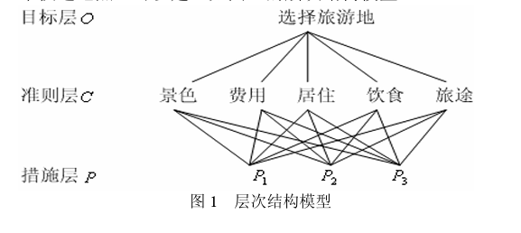

# 层次分析法（AHP）

> 整理：Zheng Zhihang（[GitHub](https://github.com/Ther-zh)）

简单说，AHP 就是把复杂的决策问题拆成几个层次，通过两两比较确定各因素的相对重要性，再算一下得到各方案的排序，帮我们做决策。评价类赛题里很常用。

## 1. 建层次结构

先把问题的目标、准则、候选方案理清楚，搭出层次结构。比如评"某地区最佳旅游路线"，可以这样分：

- 目标层：选出一条最佳旅游路线
- 准则层：风景优美度、交通便利性、花费高低、游玩舒适度
- 方案层：几条候选路线

## 2. 构造判断矩阵

判断矩阵是 AHP 的核心，靠两两比较得到：准则层的因素对目标层谁更重要，方案层的方案对每个准则谁更好。

比较用 1-9 标度法：1 是两个因素同等重要，3 是稍微重要，5 是明显重要，7 是强烈重要，9 是极端重要，2、4、6、8 介于中间。

比如比"风景优美度"和"交通便利性"对"评选最佳路线"的重要性，觉得风景稍微重要，那判断矩阵里这一项填 3，对称位置填 1/3。

## 3. 层次单排序及一致性检验

单排序：算判断矩阵的最大特征值及其特征向量，特征向量归一化之后，就是这一层对上一层各因素的权重。

一致性检验：两两比较的时候可能自相矛盾，比如 A 比 B 重要、B 比 C 重要，结果又觉得 C 比 A 重要，所以要检验一下：

1. 算判断矩阵的最大特征值 $\lambda_{max}$
2. 算一致性指标 $CI=\dfrac{\lambda_{max}-n}{n-1}$，n 是矩阵阶数
3. 查表得到平均随机一致性指标 $RI$
4. 算一致性比例 $CR=\dfrac{CI}{RI}$，CR < 0.1 就认为一致性可以接受，不然就回去改判断矩阵

## 4. 层次总排序及一致性检验

总排序：把方案层对准则层的权重、准则层对目标层的权重加权求和，得到方案层对目标层的权重。

总排序也要做一致性检验，和上面一样，CR < 0.1 就行，不然重新调整判断矩阵。
